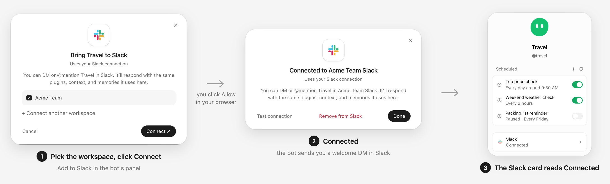

<div align="center">

# Hermes Bot Kit

**The Grok Bot experience for your Hermes fleet.**

A chat-app Bot Mode screen + a live window into your bots' computers.

[](https://github.com/NousResearch/hermes-agent)
[](#install)
[](https://github.com/thomasbek3/hermes-bot-kit/stargazers)
[](https://github.com/thomasbek3/hermes-bot-kit/commits/master)
[](LICENSE)

[](#whats-in-the-kit)
[](#requirements)
[](#requirements)
[](#install)
[](https://github.com/thomasbek3/hermes-bot-kit/pulls)

[](#install)

</div>

---

Your bots already live in Hermes. This kit makes talking to them feel like
texting a person — and lets you look over their shoulder while they work.
Desktop plugins plus an optional agent plugin, one install:

## What's in the kit

| Plugin | What it does |
|---|---|
| 🤖 **[Grokbot Override](grokbot-override/)** *(preview, the kit's main plugin, installed switched on)* | A chat-app **Bot Mode screen** on the Hermes engine, in light and dark: a roster with pinned bots and **your own named sections**, the bot's own Bot Chat in bubbles of the bot's colour with the work rows tucked away, question, approval and task cards, and a profile panel with scheduled jobs, the bot's computer, a Model row and a Slack card with **one-click Add to Slack**. Opens the **same** Bot Chat as Bot Mode (history shared both ways). Stock Bot Mode is never removed: **⌘⇧P → Grokbot Override: toggle** switches back to stock instantly (and on again). See [what's new](#new-grokbot-override) and [PARITY.md](grokbot-override/PARITY.md). |
| 🖥️ **[Computer](computer-viewer/)** | A live remote-desktop pane docked in Hermes — cloud boxes (Orgo, VPS, Docker), spare Macs, Windows PCs, Linux machines, switchable like a KVM for your fleet. **Auto-connects the moment your bot starts using its computer**, so you watch it work. Optional H.264 HD mode, per-bot computer bindings, and an agent plugin (**orgo-computer**) that gives your bots **hands** (shell + screenshot/click/type) on their pinned machine. |
| 📱 **[texting-style](texting-style/)** | An **agent plugin** that makes bots *talk* like texting, not just look like it — and **only in Bot Mode chats**: short replies, mirrors your length, no walls of text, "on it" then the result. Regular Sessions stay stock. Per-profile install, one editable doctrine string. |
| ✉️ **[email-drafts](email-drafts/)** | An **agent plugin**: bots write email as **drafts** that appear as Grok-Bot-style cards in the override's chat (editable To, Cc and body, your signature, attachments). Nothing leaves until you click **Send** (through Composio by default, using the `composio` CLI logged in on the bot's machine; or Gmail through Hermes's own OAuth sign-in, or SMTP), unless you allowed every recipient. Per-bot rules: allow recipient, needs approval, drafts off. Per-profile install. |
| 💼 **[Slack](slack-connect/)** | Optional add-ons for the override's Slack card: **one-click Add to Slack** ([slack-connect](slack-connect/README.md), with [slack-relay](slack-relay/README.md) and [slack-http](slack-http/README.md)) and **Test connection** ([slack-check](slack-check/README.md)). |

<p align="center">
  
</p>
<p align="center"><em>Grokbot Override with demo bots, rendered from the plugin's preview harness.</em></p>


## Experimental inspiration

[Inner Circle](inner-circle/) is a personal, bot-centric Hermes preset shared
for inspiration: sage chat, portrait folders and less session clutter. The
complete implementation is maintained separately; this is an invitation to
review and reuse it if useful. It is opt-in and not part of this installer.

## Install

One command, the desktop plugins (idempotent, no sudo, agents can run it unattended):

```bash
curl -fsSL https://raw.githubusercontent.com/thomasbek3/hermes-bot-kit/v2026.11.10.4/install.sh | bash
```

Then in Hermes Desktop: **⌘K → Reload plugins** (or restart the app).

- Grokbot Override is installed **switched on**: its Bots tab replaces the
  stock one. **⌘⇧P → Grokbot Override: toggle** switches back to stock Bot
  Mode (and on again); a choice you made before is kept on upgrade.
- The Computer pane: enable **Computer** in **Settings → Plugins**, then add a
  computer — see the [computer-viewer README](computer-viewer/README.md) for
  connecting cloud boxes, spare Macs/PCs, HD mode, and giving bots hands.

The bots' **agent-cards skill** (approval, task and email-draft cards in the
Grokbot Override chat) is opt-in: run the installer from a clone with
`KIT_CARDS_SKILL=1` (and `KIT_CARDS_SKILL=remove` to take it out again). See
[Cards](grokbot-override/README.md#cards).

Want just one plugin? `KIT_SKIP_COMPUTER=1` or `KIT_SKIP_GROKBOT=1` in front
of the command, or use each plugin's own install instructions.

**Retired on 2026-11-10:** Bubble Mode, Bot Sections and Task Dock. Grokbot
Override took over what the kit still used from them: its own roster sections
(your Bot Sections layout is copied over once, the old data is left as it was)
and its own work-rows setting. Task Dock was not ported. If an older install
left their folders in `desktop-plugins/`, the installer says so; run it with
`KIT_REMOVE_RETIRED=1` to move exactly those kit folders to
`desktop-plugins-retired-<date>/` (nothing is deleted).

**texting-style** is an *agent* plugin (it changes how bots write, per Hermes
profile), so it has its own one-liner:

```bash
curl -fsSL https://raw.githubusercontent.com/thomasbek3/hermes-bot-kit/v2026.11.10.4/texting-style/install.sh | bash
```

**Installing via an AI agent?** Point it at [AGENTS.md](AGENTS.md) — exact
unattended install, verify, and uninstall steps, plus the footguns. (Most
coding agents read that file automatically.)

## New: Grokbot Override

<p align="center">
  
</p>
<p align="center"><em>Demo bots, rendered from the plugin's preview harness. More pictures: <a href="grokbot-override/README.md">Grokbot Override README</a>.</em></p>

What you get:

- **One-click Add to Slack.** In a bot's profile panel: **Connect** → you click
  **Allow** in your browser → **Connected**, and the bot sends you a welcome DM.
  One click (**Remove from Slack**) removes it again. Every new bot's Slack app
  gets the full set of permissions it needs. Requires an always-on Hermes host
  with a public HTTPS address and one Slack configuration token per workspace;
  without it, the paste-two-tokens window still works. See
  [slack-connect/README.md](slack-connect/README.md).
- **A chat-app look in light and dark.** Follows Hermes's theme switch; flat
  bot bubbles, your bubbles in the open bot's colour.
- **Pinned bots.** Right-click a bot → **Pin to top** puts up to four big
  avatars above the roster. Each bot gets a simple shape in its own colour
  unless it has a photo.
- **Cards in the chat.** Question cards from Hermes's built-in `clarify` tool
  work out of the box; approval, task and email-draft cards update live once
  the bot has the kit's agent-cards skill (`KIT_CARDS_SKILL=1 bash install.sh`,
  off by default). See [Cards](grokbot-override/README.md#cards).
- **A profile panel** with scheduled jobs, the bot's computer, a **Slack**
  card (**Test connection** asks Slack itself through the optional
  [slack-check](slack-check/README.md) backend plugin) and a **Model** row.
- **A NEW line** above the first message you have not seen, and a footer with
  your name and a button to Hermes Settings.
- **Your own roster sections.** **+ → New section**, right-click a section
  header to rename, move or delete it, click it to collapse; right-click a
  bot → **Move to section**.
- **Hidden work rows.** Thinking and tool rows stay out of the chat by default.
  **⌘⇧P → Grokbot Override: show work rows** brings them back.

<p align="center">
  
</p>

The override is a preview: it is checked against the Hermes source it was
built on, not live-qualified on every Hermes version (see the
[Grokbot Override README](grokbot-override/README.md)).

## Requirements

- **Hermes Desktop ≥ 0.20.5**. Source contracts re-checked against stable
  **v0.23.0** (`2bd378ed1b8d6bf2192cb26e0a55ff3091e6bd19`, 2026-11-07).
  See [compatibility and verification limits](docs/COMPATIBILITY.md).
- The desktop plugins are single-file disk plugins: no build step, no core
  patches, hot-reloadable, and they fail safe (if a Hermes update renames
  internal hooks, they render stock instead of breaking).

## Repository layout

```
install.sh          one-command installer for the desktop plugins
grokbot-override/   Grokbot Override: src/, the built plugin.js, tests, docs
slack-check/        optional backend plugin: the Slack card's Test connection
slack-connect/      optional Add to Slack add-on (with slack-relay/, slack-http/)
texting-style/      agent plugin: SMS-register reply style, per profile
email-drafts/       agent plugin: email drafts the user sends from a chat card, per profile
computer-viewer/    Computer: plugin, host connect scripts, HD agent,
                    orgo-computer agent plugin, orgo-term / orgo-hands, docs
SECURITY.md         security policy (VNC/networking guidance lives in the
                    computer-viewer README)
```

## Formerly `hermes-computer-viewer`

This repo was renamed on 2026-08-27 and absorbed `hermes-bubble-mode`
(archived; Bubble Mode itself was retired from the kit on 2026-11-10, its
history stays in git). GitHub redirects all old repo links. The host scripts
live in `computer-viewer/` (for example
`computer-viewer/connect-mac.sh`); the root shims that forwarded there were
removed on 2026-11-10, so one-liners pinned to an older release tag keep
working while new ones use the `computer-viewer/` path.

## Fine print

Independent community project. Not built by, endorsed by, or affiliated with
Nous Research, xAI, Orgo, or Tailscale. "Grok" and "Grok Bot" are trademarks
of their respective owner — this kit simply chases the same feel for Hermes.
Parts of the agent plugin are adapted from
[Korgo Bot](https://github.com/nickvasilescu/korgo-bot) (MIT) — see
[computer-viewer/NOTICE.md](computer-viewer/NOTICE.md).

MIT — see [LICENSE](LICENSE).
