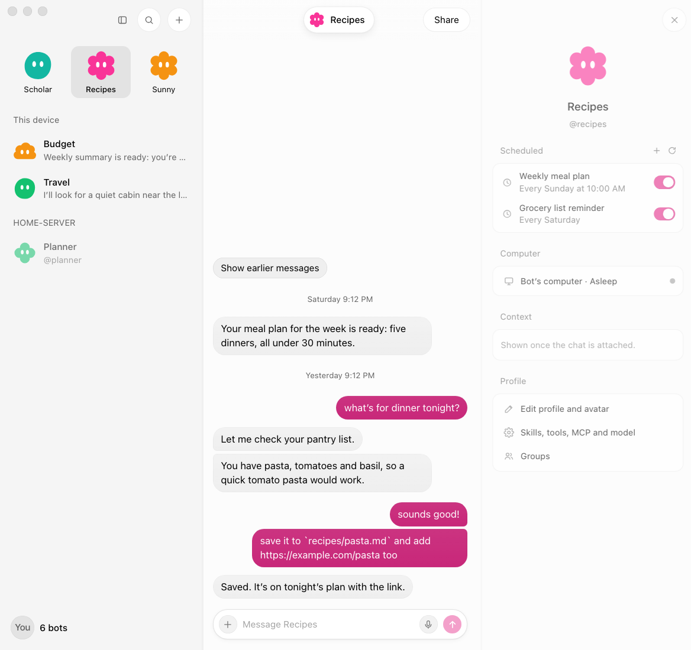
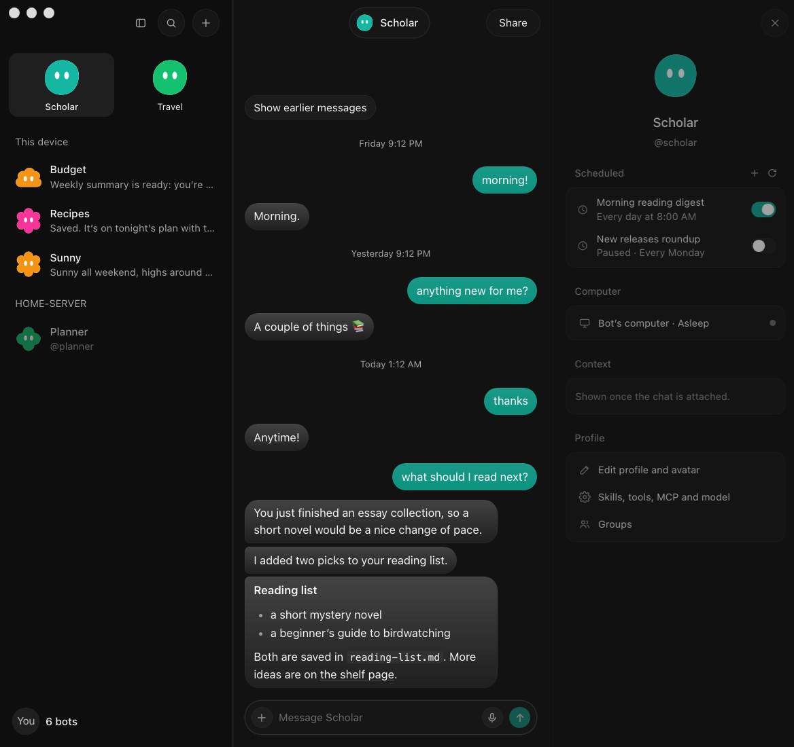
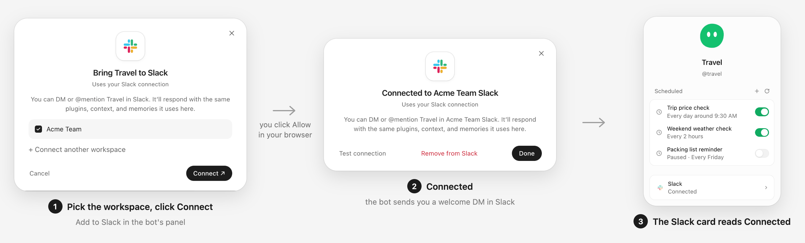

<div align="center">

# Hermes Bot Kit

**The Grok Bot experience for your Hermes fleet.**

A chat-app Bot Mode screen + a live window into your bots' computers.

[](docs/COMPATIBILITY.md)
[](#install)
[](https://github.com/thomasbek3/hermes-bot-kit/stargazers)
[](https://github.com/thomasbek3/hermes-bot-kit/commits/master)
[](LICENSE)

[](#whats-in-the-kit)
[](#requirements)
[](#requirements)
[](#install)
[](https://github.com/thomasbek3/hermes-bot-kit/pulls)

[](#install)

</div>

> **Quick start**
> 1. Tell your AI agent: **"Install https://github.com/thomasbek3/hermes-bot-kit (follow its AGENTS.md)."**
> 2. Or yourself: `( set -e; f=$(mktemp); trap 'rm -f "$f"' EXIT; curl -fsSL https://raw.githubusercontent.com/thomasbek3/hermes-bot-kit/v2026.11.16.3/install.sh -o "$f"; test -s "$f"; bash "$f" )`
> 3. Then **⌘K → Reload desktop plugins** in Hermes Desktop (Ctrl+K on Windows and Linux): the Bots tab becomes the chat-app screen.
> 4. Not working? `bash install.sh --doctor` (or the one-liner with `--doctor` after `bash "$f"`) tells you why. See [Troubleshooting](#troubleshooting).

## Getting started

1. **Install.** Run the one-liner above (or `bash install.sh` in a clone).
   **You should see** the release on the first line and, near the end:
   ```
   Release          -> v2026.11.16.3 (newest GitHub release)
   ...
   Computer viewer  -> ~/.hermes/desktop-plugins/computer-viewer/plugin.js (+ helper scripts)
   Grokbot Override -> ~/.hermes/desktop-plugins/grokbot-override/plugin.js (switched on unless you turned it off before)
   ```
   (The real path is your Hermes home; the release can be newer.) An error
   line means nothing was installed: see [Troubleshooting](#troubleshooting).
2. **Reload plugins.** In Hermes Desktop open the command palette with
   **⌘K** (macOS) or **Ctrl+K** (Windows, Linux) (**⌘P** / **Ctrl+P** work
   too), type `reload`, and pick **Reload desktop plugins**. Or quit and
   reopen Hermes Desktop. **You should see** no message; the screen changes
   in the next step. (Hermes has no ⌘⇧P shortcut, so that one does nothing.)
3. **Open the Bots tab.** It is the **BOTS** tab next to **SESSIONS** at the
   top of the left sidebar. **You should see** the chat-app roster instead of
   the stock Bot Mode list.
4. **What it looks like.** Your bots on the left with pinned bots on top, the
   open chat in the middle in the bot's colour, and the bot's profile on the
   right, in light or dark with Hermes's theme:

   <p align="center">
     
     
   </p>

   The **Computer** pane is on by default; its switch, and Grokbot
   Override's, is in **Capabilities → Plugins** (Capabilities is in the
   sidebar, or **⌘K → Capabilities**).
5. **Switch back any time.** **⌘K → Grokbot Override: toggle** brings back
   stock Bot Mode instantly, and the same command turns the override on
   again. Your choice is kept across updates.

## Troubleshooting

**Run the doctor first.** It only reads, changes nothing, and prints one
line per check (`OK`, `FIX` or `INFO`), each `FIX` with the exact command
that fixes it:

```bash
( set -e; f=$(mktemp); trap 'rm -f "$f"' EXIT; curl -fsSL https://raw.githubusercontent.com/thomasbek3/hermes-bot-kit/v2026.11.16.3/install.sh -o "$f"; test -s "$f"; bash "$f" --doctor )
```

From a clone: `bash install.sh --doctor` (or `bash scripts/doctor.sh`). It
ends with a summary between two `--- doctor summary ---` lines; paste that
into a [not-working issue](https://github.com/thomasbek3/hermes-bot-kit/issues/new/choose).
It holds no paths, names or tokens: only versions, plugin names, a home
category and OK/FIX/INFO per check.

| What you see | Why, and the fix |
|---|---|
| Nothing changed after installing | Plugins were not reloaded: **⌘K → Reload desktop plugins** (Ctrl+K on Windows and Linux) or restart the app. ⌘⇧P is not a Hermes shortcut. |
| The Bots tab still looks stock | The override is switched off: **⌘K → Grokbot Override: toggle**. |
| Installed, but Hermes doesn't load it | It went into another Hermes home. Hermes Desktop reads `~/.hermes/desktop-plugins` (or `HERMES_HOME`). A `HERMES_HOME` set only in your shell profile does not reach an app opened from the Dock. The doctor names the home Desktop uses. |
| You copied the folder by hand or unzipped the repo | The folders must be exactly `desktop-plugins/grokbot-override` and `desktop-plugins/computer-viewer`, one level down. Hermes doesn't load `desktop-plugins/hermes-bot-kit-main/grokbot-override`. The doctor prints the `mv` command. |
| Plugins under `profiles/<name>/desktop-plugins` | Desktop plugins belong to the app, not a profile. Hermes moves them up by itself when it next scans its plugins, unless a copy is already there; the doctor prints the move. |
| `duplicate id "grokbot-override"` in Capabilities → Plugins | Two copies of one plugin. Move the extra one out (the doctor names it). |
| `plugin.js exceeds this shell's 512 KiB read limit` | Hermes Desktop is too old for the override's file size. Update Hermes Desktop. |
| `install.sh: sha256 mismatch for …` | A download was not the released file (proxy, cut-off download). Nothing was installed. Run it again. |
| Bubble Mode, Task Dock or Bot Sections still installed | Retired in 2026-11. Run the installer with `KIT_REMOVE_RETIRED=1` in front of `bash` (it moves them aside; nothing is deleted). |
| Hermes Desktop older than 0.23.0 | Not supported (see [Requirements](#requirements)): update Hermes Desktop. The doctor prints your version. |
| Hermes Desktop on Windows | The installer is a bash script for macOS and Linux. Desktop on Windows reads `HERMES_HOME`, else `%LOCALAPPDATA%\hermes` (an older `%USERPROFILE%\.hermes` only when that doesn't exist). From the release's source zip, copy the `grokbot-override` and `computer-viewer` folders and `MANIFEST.sha256` into its `desktop-plugins\` (folder names exactly as shown, `plugin.js` one level down), then reload. To verify in PowerShell: `$d="$env:LOCALAPPDATA\hermes\desktop-plugins"; foreach ($l in Get-Content "$d\MANIFEST.sha256") { $h,$p = $l -split '\s+',2; if ($p -like 'computer-viewer/*' -or $p -eq 'grokbot-override/plugin.js') { if (!(Test-Path "$d\$p") -or (Get-FileHash "$d\$p").Hash -ne $h) { "FIX: copy $p again" } } }; "checked"`. Each `FIX:` line names a file to copy again from the zip. |
| Hermes Desktop for Windows with the installer run in WSL | Different homes: WSL's `~/.hermes` is not Desktop's `%LOCALAPPDATA%\hermes`. Copy the folders and `MANIFEST.sha256` into that one's `desktop-plugins` as above. The doctor run in WSL checks your Windows home when it can see it (through `cmd.exe`); when it can't, it marks the home unverified and exits 2. |

Still stuck? [Open a not-working issue](https://github.com/thomasbek3/hermes-bot-kit/issues/new/choose)
with the doctor summary. Agents installing the kit: [AGENTS.md](AGENTS.md)
has more.

---

Your bots already live in Hermes. This kit makes talking to them feel like
texting a person — and lets you look over their shoulder while they work.
Desktop plugins plus an optional agent plugin, one install:

## What's in the kit

| Plugin | What it does |
|---|---|
| 🤖 **[Grokbot Override](grokbot-override/)** *(preview, the kit's main plugin, installed switched on)* | A chat-app **Bot Mode screen** on the Hermes engine, in light and dark: a roster with pinned bots and **your own named sections**, the bot's own Bot Chat in bubbles of the bot's colour with the work rows tucked away, question, approval and task cards, and a profile panel with scheduled jobs, the bot's computer, a Model row and a Slack card with **one-click Add to Slack**. Opens the **same** Bot Chat as Bot Mode (history shared both ways). Stock Bot Mode is never removed: **⌘K → Grokbot Override: toggle** switches back to stock instantly (and on again). See [what's new](#new-grokbot-override) and [PARITY.md](grokbot-override/PARITY.md). |
| 🖥️ **[Computer](computer-viewer/)** | A live remote-desktop pane docked in Hermes — VPS and Docker boxes, spare Macs, Windows PCs, Linux machines, switchable like a KVM for your fleet. **Opens the moment your bot calls Hermes's own `computer_use` or browser tools** on its bound machine, so you watch it work, and **Take over / Hand back** for Macs the bot drives over SSH. Optional H.264 HD mode and per-bot computer bindings. |
| 📱 **[texting-style](texting-style/)** | An **agent plugin** that makes bots *talk* like texting, not just look like it — and **only in Bot Mode chats**: short replies, mirrors your length, no walls of text, "on it" then the result. Regular Sessions stay stock. Per-profile install, one editable doctrine string. |
| ✉️ **[email-drafts](email-drafts/)** | An **agent plugin**: bots write email as **drafts** that appear as Grok-Bot-style cards in the override's chat (editable To, Cc and body, your signature, attachments). Nothing leaves until you click **Send** (through Composio by default, using the `composio` CLI logged in on the bot's machine; or Gmail through Hermes's own OAuth sign-in, or SMTP), unless you allowed every recipient. Per-bot rules: allow recipient, needs approval, drafts off. Per-profile install. |
| 🛰️ **[remote-cua](remote-cua/)** | An **agent plugin**: Hermes's own `computer_use` tool drives a **remote Mac** over SSH (cua-driver's private daemon started through the exact pinned app, one SSH session per run), with a take-over lease the Computer pane uses for **Take over / Hand back**. Windows is accepted in config and refused for now. Linux VMs use Hermes's native path instead ([docs/LINUX-VM.md](docs/LINUX-VM.md)). Per-profile install. |
| 💼 **[Slack](slack-connect/)** | Optional add-ons for the override's Slack card: **one-click Add to Slack** ([slack-connect](slack-connect/README.md), with [slack-relay](slack-relay/README.md) and [slack-http](slack-http/README.md)) and **Test connection** ([slack-check](slack-check/README.md)). |

<p align="center">
  
</p>
<p align="center"><em>Grokbot Override with demo bots, rendered from the plugin's preview harness.</em></p>


## Install

One command, the desktop plugins (idempotent, no sudo, agents can run it unattended):

```bash
( set -e; f=$(mktemp); trap 'rm -f "$f"' EXIT; curl -fsSL https://raw.githubusercontent.com/thomasbek3/hermes-bot-kit/v2026.11.16.3/install.sh -o "$f"; test -s "$f"; bash "$f" )
```

(It downloads the script to a file and runs it only if the download worked, so
a failed or empty download stops with an error instead of doing nothing.)

It installs the newest release (it asks GitHub, and falls back to the release
it came with) and checks every file against that release's `MANIFEST.sha256`
before copying anything. Then in Hermes Desktop: **⌘K → Reload desktop
plugins** (Ctrl+K on Windows and Linux), or restart the app.

- Grokbot Override is installed **switched on**: its Bots tab replaces the
  stock one. **⌘K → Grokbot Override: toggle** switches back to stock Bot
  Mode (and on again); a choice you made before is kept on upgrade.
- The Computer pane is on by default (its switch is in **Capabilities →
  Plugins**); add a computer in it — see the [computer-viewer README](computer-viewer/README.md) for
  connecting cloud boxes, spare Macs/PCs, HD mode, and giving bots hands.

The bots' **agent-cards skill** (approval, task and email-draft cards in the
Grokbot Override chat) is opt-in: run the installer from a clone with
`KIT_CARDS_SKILL=1` (and `KIT_CARDS_SKILL=remove` to take it out again). See
[Cards](grokbot-override/README.md#cards).

Want just one plugin? `KIT_SKIP_COMPUTER=1` or `KIT_SKIP_GROKBOT=1` in front
of the command, or use each plugin's own install instructions.

**Retired on 2026-11-10:** Bubble Mode, Bot Sections and Task Dock. Grokbot
Override took over what the kit still used from them: its own roster sections
(your Bot Sections layout is copied over once, the old data is left as it was)
and its own work-rows setting. Task Dock was not ported. If an older install
left their folders in `desktop-plugins/`, the installer says so; run it with
`KIT_REMOVE_RETIRED=1` to move exactly those kit folders to
`desktop-plugins-retired-<date>/` (nothing is deleted).

**texting-style** is an *agent* plugin (it changes how bots write, per Hermes
profile), so it has its own one-liner:

```bash
( set -e; f=$(mktemp); trap 'rm -f "$f"' EXIT; curl -fsSL https://raw.githubusercontent.com/thomasbek3/hermes-bot-kit/v2026.11.16.3/texting-style/install.sh -o "$f"; test -s "$f"; bash "$f" )
```

**remote-cua** is an *agent* plugin too (per bot profile, on the gateway host):
`bash remote-cua/install.sh --profiles helper` from a clone, then set
`computer_use.backend: remote-cua` and a `remote_cua` block in that profile's
`config.yaml`. Mac setup and the check command: [remote-cua/README.md](remote-cua/README.md).

**Installing via an AI agent?** Point it at [AGENTS.md](AGENTS.md): exact
unattended prerequisites, install, verify, reload and uninstall steps for macOS
and Linux, plus troubleshooting. (Most coding agents read that file
automatically.)

**Putting a bot in Slack?** [docs/SLACK.md](docs/SLACK.md) is a step-by-step
runbook (for you or your agent): Socket Mode with two tokens, or one-click
**Add to Slack** with the kit's relay, and which steps only you can do.

## New: Grokbot Override

<p align="center">
  
</p>
<p align="center"><em>Demo bots, rendered from the plugin's preview harness. More pictures: <a href="grokbot-override/README.md">Grokbot Override README</a>.</em></p>

What you get:

- **One-click Add to Slack.** In a bot's profile panel: **Connect** → you click
  **Allow** in your browser → **Connected**, and the bot sends you a welcome DM.
  One click (**Remove from Slack**) removes it again. Every new bot's Slack app
  gets the full set of permissions it needs. Requires an always-on Hermes host
  with a public HTTPS address and one Slack configuration token per workspace;
  without it, the paste-two-tokens window still works. See
  [slack-connect/README.md](slack-connect/README.md).
- **A chat-app look in light and dark.** Follows Hermes's theme switch; flat
  bot bubbles, your bubbles in the open bot's colour.
- **Pinned bots.** Right-click a bot → **Pin to top** puts up to four big
  avatars above the roster. Each bot gets a simple shape in its own colour
  unless it has a photo.
- **Cards in the chat.** Question cards from Hermes's built-in `clarify` tool
  work out of the box; approval, task and email-draft cards update live once
  the bot has the kit's agent-cards skill (`KIT_CARDS_SKILL=1 bash install.sh`,
  off by default). See [Cards](grokbot-override/README.md#cards).
- **A profile panel** with scheduled jobs, the bot's computer, a **Slack**
  card (**Test connection** asks Slack itself through the optional
  [slack-check](slack-check/README.md) backend plugin) and a **Model** row.
- **A NEW line** above the first message you have not seen, and a footer with
  your name and a button to Hermes Settings.
- **Your own roster sections.** **+ → New section**, right-click a section
  header to rename, move or delete it, click it to collapse; right-click a
  bot → **Move to section**.
- **Hidden work rows.** Thinking and tool rows stay out of the chat by default.
  **⌘K → Grokbot Override: show work rows** brings them back.

<p align="center">
  
</p>

The override is a preview: it is checked against the Hermes source it was
built on, not live-qualified on every Hermes version (see the
[Grokbot Override README](grokbot-override/README.md)).

## Requirements

- **Hermes Desktop ≥ 0.23.0.** Source contracts checked on 2026-11-19 against
  stable **v0.23.2** (`ae2a81cc`, 2026-11-16), **v0.23.0** (`2bd378ed`) and
  upstream main; v0.23.1 was not checked on its own. Older releases are not
  supported: v0.22.7 has no group-chat Continue, and v0.21.x lacks several
  APIs the plugins use. See
  [compatibility and verification limits](docs/COMPATIBILITY.md).
- The desktop plugins are single-file disk plugins: no build step, no core
  patches, hot-reloadable, and they fail safe (if a Hermes update renames
  internal hooks, they render stock instead of breaking).

## Repository layout

```
install.sh          one-command installer for the desktop plugins (--doctor: checks)
scripts/doctor.sh   read-only checks for "it isn't working", with a paste-able summary
grokbot-override/   Grokbot Override: src/, the built plugin.js, tests, docs
slack-check/        optional backend plugin: the Slack card's Test connection
slack-connect/      optional Add to Slack add-on (with slack-relay/, slack-http/)
texting-style/      agent plugin: SMS-register reply style, per profile
email-drafts/       agent plugin: email drafts the user sends from a chat card, per profile
remote-cua/         agent plugin: native computer_use on a remote Mac over SSH, take-over lease
computer-viewer/    Computer: plugin, host connect scripts, HD agent, docs
docs/               SLACK.md (Slack runbook), compatibility notes, LINUX-VM.md
SECURITY.md         security policy (VNC/networking guidance lives in the
                    computer-viewer README)
```

## Formerly `hermes-computer-viewer`

This repo was renamed on 2026-08-27 and absorbed `hermes-bubble-mode`
(archived; Bubble Mode itself was retired from the kit on 2026-11-10, its
history stays in git). GitHub redirects all old repo links. The host scripts
live in `computer-viewer/` (for example
`computer-viewer/connect-mac.sh`); the root shims that forwarded there were
removed on 2026-11-10, so one-liners pinned to an older release tag keep
working while new ones use the `computer-viewer/` path.

## Fine print

Independent community project. Not built by, endorsed by, or affiliated with
Nous Research, xAI, or Tailscale. "Grok" and "Grok Bot" are trademarks
of their respective owner — this kit simply chases the same feel for Hermes.
The Computer pane studied
[Korgo Bot](https://github.com/nickvasilescu/korgo-bot) (MIT) for UI patterns — see
[computer-viewer/NOTICE.md](computer-viewer/NOTICE.md).

MIT — see [LICENSE](LICENSE).
