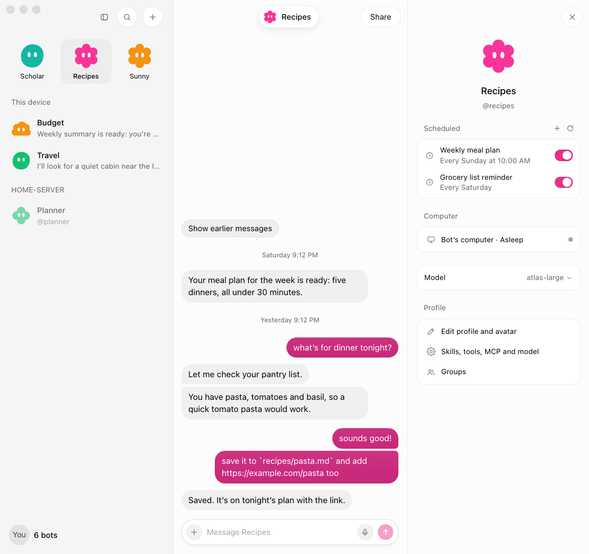
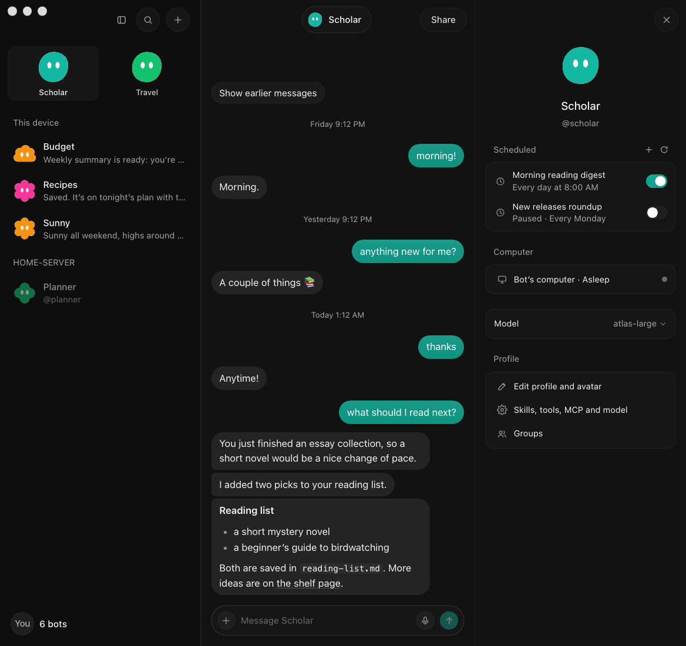

# Grokbot Override

A chat-app Bot Mode screen for Hermes Desktop: a roster sidebar, the bot's chat with a floating name pill,
and a profile panel with scheduled jobs. It runs on the Hermes engine and opens the **same** Bot Chat
Hermes Bot Mode opens, so history is shared both ways.

<p align="center">
  
  
</p>

The look follows Hermes's light and dark themes. Each bot wears a simple shape (blob, cloud, clover, flower,
heart, hexagon, house, sparkle, square, star, teardrop or pebble) in its own colour, chosen from its exact
route key; a bot with a photo shows the photo. Your bubbles, the send button and switches take the open
bot's colour. Thinking and tool rows are hidden in the chat unless Bubble Mode's "toggle work rows"
preference shows them.

Hermes Bot Mode is never removed or disabled. The override hides the stock **Bots** tab while it is on and
does the chat itself: creating a Bot Chat, answering questions and password prompts, slash commands and
skills, @mentions, tool detail, media, edit / regenerate / rewind, reactions, voice input, chats side by
side, unread dots and gateway group chats. The palette toggle is the escape hatch back to stock; **Open in
Hermes Bot Mode** shows up only in error states. The full capability list is in [PARITY.md](PARITY.md).

## Use

- Command palette → **Grokbot Override: toggle**. On: the override's **Bots** tab replaces the stock
  **Bots** tab in the sidebar; clicking a bot opens its chat in a main-area tab captioned with the bot's
  name (it follows the bot you switch to). Off: stock Bot Mode is back at once. The override stays off in
  Hermes's HUD window (`?win=hud`), which has no sidebar.
- **Grokbot Override: open Hermes Bot Mode for this bot**: shows the stock Bots tab and opens this
  bot's Bot Chat there, always with the bot's exact connection route. A bot whose route is not known
  yet (a remote row still loading) is refused with a message instead: Hermes given only a profile name
  opens a same-named profile on this machine. Clicking the override's **Bots** tab again hides the
  stock tab.
- Rows on an SSH connection that is not the live gateway (`connect-on-demand`) are available, as in
  Bot Mode; only a source Bot Mode marks unavailable or removed is dimmed.
- **Pin to top** (row menu) puts up to four bots as big avatars above the roster; the pins live in the
  override's own plugin storage and never touch Bot Mode's data.
- The profile panel's **Slack** card shows whether the bot is in Slack. **Test connection** asks Slack
  itself (`auth.test`) through the optional [slack-check](../slack-check/README.md) backend plugin;
  when the backend does not have it, the card shows a short hint in place of the button. **Add to Slack** is an optional add-on
  ([slack-connect](../slack-connect/README.md)) that needs an always-on Hermes host with a public HTTPS
  address.
- Right-click a bot (or its ⋯) for pin, hide, edit profile, skills / tools / model, groups, duplicate,
  delete, a new chat or a second override chat tab beside the first. **+** creates a bot (its Bot Chat is
  born with the intro, as in Bot Mode) or a gateway group chat. The filter button narrows the roster by
  kind (bots / group chats), activity and gateway; hidden bots sit in a **Hidden** section at the bottom.
- **Group chats** (gateway-owned rooms) are listed under the bots and open as their own tab. A member's
  failed group turn puts the needs-attention badge on its row, like a failed Bot Chat turn.
- The profile panel creates, edits, runs and deletes scheduled jobs, opens the bot's computer (live screen
  with take over / hand back), lists the group chats the bot is in, and shows the bot's model in one row
  that opens the model picker. The open chat's context and cost meter is in the status bar.
- Palette doors: **new bot**, **edit this bot's profile**, **this bot's skills, tools and model**, **new
  scheduled job for this bot**, **open this bot's computer**.
- **Grokbot Override: self-check (read-only)**: reads the roster, one bot's Bot Chat registry and history
  tail, and its cron list, then writes counts (never message text) to the plugin's data folder as
  `self-check.json`.

A bot that has never been opened has no Bot Chat yet. Clicking it creates one exactly as Bot Mode does
(registry first, adopt the existing chat on a conflict, so the two can never make two); a chat tab that
merely restores the last bot offers **Start Bot Chat** instead.

## Supported Hermes version

Built and checked against **Hermes Agent `2bd378ed1b`** (Desktop plugin SDK, gateway contract and Bot
Mode source at that commit). It reads private Bot Mode details (its roster cache key, the Bot Sections
plugin's storage, the stock tab's DOM attribute and pane id) and classifies gateway errors (`prompt.submit`, steer, slash
commands, rewind, title) from that commit's gateway source, all in one module (`src/core/outcomes.js`):
only a documented refusal raised before anything ran authorizes a fallback or a second write. There is no pinned upstream contract suite yet, so
on any other Hermes version treat it as unverified: turn it off (palette toggle) if Bot Mode misbehaves.
It is a preview, not live-qualified (see [PARITY.md](PARITY.md)). Every Hermes-facing change is tested by
loading the built `plugin.js` the way Hermes's runtime loader does (`test/hermes-loader.mjs`, one harness
for every `test/loader-*.test.mjs`): a smoke test renders every surface, with and without the SDK's dialog
and menu parts, and a click-through drives roster → chat → bot switches → profile → every dialog.

## Sending: never twice

Every message carries a submission id, as Bot Mode's do. A message is sent again only after Hermes
definitely refused it (the draft comes back to the composer, or the bubble offers **Retry**), or, when the
outcome is unknown, under the **same** submission id, which Hermes recognises and never runs twice. A
gateway that does not take submission ids gets the message once without one; if that outcome is unknown,
the override never offers to send it again: it reads the chat history for it (read-only, also via **Check
again**). Group-chat posts follow the same rule with their event id.

## Background work and the 30-minute cap

A chat on a pooled (secondary) connection holds that connection open with one lease while its Chat tab
shows it. Closing the tab or switching bots releases it at once when nothing is running. A send in flight
or a running turn keeps the chat attached in the background until it settles, **at most 30 minutes**; then
it is disposed even if the turn is still running. This is a resource cap, not a promise: releasing the
last lease on a pooled connection can let the gateway reap the runtime, so work that runs past the cap
after you closed its tab may stop. Keep the Chat tab open (or use Hermes Bot Mode) for long jobs. Turning
the override off disposes every chat at once.

## Install

The kit's root `install.sh` installs it with the other desktop plugins (skip it with `KIT_SKIP_GROKBOT=1`).
It installs `plugin.default-off.js` as `~/.hermes/desktop-plugins/grokbot-override/plugin.js`: the same
bundle with the toggle starting **off**, so stock Bot Mode is unchanged until you run **Grokbot Override:
toggle** (the choice is remembered in the override's plugin storage). Reload plugins or restart Hermes
Desktop after installing.

By hand: copy `plugin.js` (toggle starts on) or `plugin.default-off.js` (starts off) to
`~/.hermes/desktop-plugins/grokbot-override/plugin.js`. The folder name must stay `grokbot-override` (it
is the plugin id). Either way, a toggle you have already set wins over the file's default.

`plugin.js` is self-contained for licensing too: its leading `/*!` comment carries the full MIT texts (this
kit, Hermes Agent and the layout CSS in `src/ui/styles-ref.ts`), the full Apache License 2.0 text and the
Rakazo attribution and modification note, so copying the one file passes on everything its recipients are
owed. The same texts sit beside it in this folder (`LICENSE-APACHE-2.0`, `LICENSE-HERMES-AGENT-MIT`,
`LICENSE-THIRD-PARTY-MIT`, `NOTICE.md`) and the kit's root `LICENSE`.

## Build and test

```bash
cd grokbot-override
npm ci                 # esbuild, react and react-dom (dev only)
npm run build          # src/ -> plugin.js and plugin.default-off.js (commit both)
npm run check          # fails if either is stale
npm test               # node:test; the render, app-layer and loader smoke tests need `npm ci`
node dev/preview.mjs out/   # fixture-data preview pages (HTML + SVG)
node dev/preview.mjs out/ --live   # framed like the live window, plus avatars-sheet.html
```

`node build.mjs --default-off --out <file>` writes a single copy whose toggle starts off (that is what
`plugin.default-off.js` is). `--probe` additionally runs the read-only self-check once,
six seconds after load.

## Licences

MIT, except the Rakazo-derived palette, type scale and colour maths (Apache-2.0, see `NOTICE.md` and
`LICENSE-APACHE-2.0`), small ports from Hermes Agent (MIT, Nous Research, see `LICENSE-HERMES-AGENT-MIT`)
and the layout CSS in `src/ui/styles-ref.ts` (MIT, see `LICENSE-THIRD-PARTY-MIT`). The avatar shapes are
original to this kit.
`build.mjs` embeds all of these texts in `plugin.js`.
