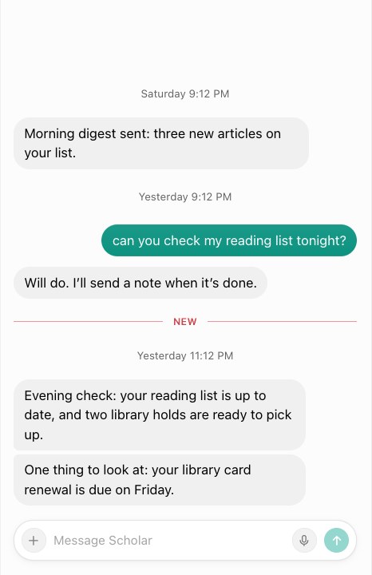
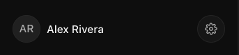
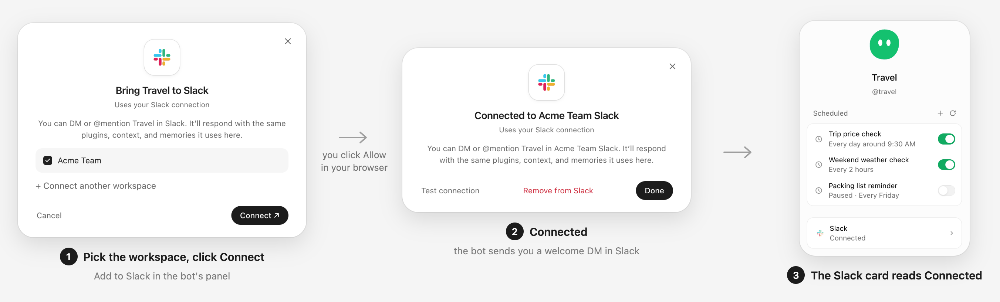
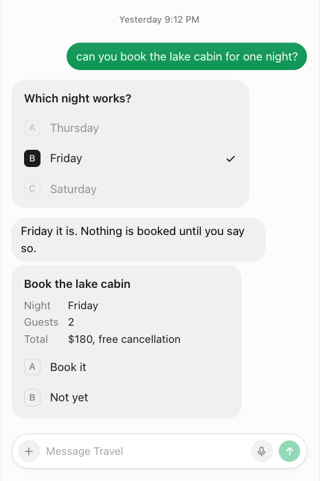
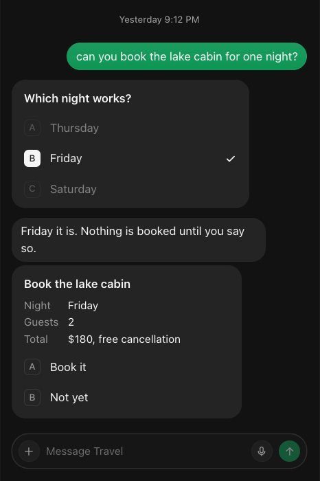

# Grokbot Override

A chat-app Bot Mode screen for Hermes Desktop: a roster sidebar, the bot's chat with a floating name pill,
and a profile panel with scheduled jobs. It runs on the Hermes engine and opens the **same** Bot Chat
Hermes Bot Mode opens, so history is shared both ways.

<p align="center">
  
  
</p>
<p align="center"><em>Demo bots and demo text, rendered from the preview harness (<code>dev/</code>).</em></p>

The look follows Hermes's light and dark themes. Each bot wears a simple shape (blob, cloud, clover, flower,
heart, hexagon, house, sparkle, square, star, teardrop or pebble) in its own colour, chosen from its exact
route key; a bot with a photo shows the photo. Your bubbles, the send button and switches take the open
bot's colour; the bot's bubbles are one flat grey. Thinking and tool rows, and "Background task finished" lines, are hidden in the chat until the
palette's **Grokbot Override: show work rows** turns them on (the same command hides them again; a background line never prints the command's path, which is in its tooltip). A thin red **NEW** line marks the first bot message you have not
seen when you open a chat. The sidebar footer shows your initials and name (this computer's account name, the only
one Hermes gives plugins; "You" without it) and a round button that opens Hermes Settings. The transcript stays put
while you scroll past live cards, and message actions float beside the message on hover. Code blocks in a bot's reply show in full (a
long one folds behind **Show more**) with a **Copy** button. A file the bot sends (a `MEDIA:` line naming a
document, not an image or a recording) is a card under its bubble: a tile by type (a green sheet for spreadsheets,
PDF, image, document), the name, its size and a download button. Clicking the card opens a large viewer over the
chat: spreadsheets (`.xlsx`, `.xls`, `.ods`, `.csv`, `.tsv`) as a grid with sheet tabs where you can select cells
with the mouse or arrow keys (Shift extends) and copy them with ⌘C; PDFs in the built-in PDF viewer; images fit to
the window (click to zoom); text and markdown with **Copy all**; anything else, or a file over 25 MB, with
**Download**. Escape closes it. When a bot chooses not to reply
(it answers with `[SILENT]` or `NO_REPLY`), nothing is shown: no bubble, no preview line, no unread dot.

<p align="center">
  
  
</p>

Hermes Bot Mode is never removed or disabled. The override hides the stock **Bots** tab while it is on and
does the chat itself: creating a Bot Chat, answering questions and password prompts, slash commands and
skills, @mentions, tool detail, media, choice cards for the bot's questions, live `::card` and `::preview`
widgets, edit / regenerate / rewind, reactions, voice input, chats side by side, unread dots and gateway
group chats. The palette toggle is the escape hatch back to stock; **Open in
Hermes Bot Mode** shows up only in error states. The full capability list is in [PARITY.md](PARITY.md).

## Use

- Command palette → **Grokbot Override: toggle**. On: the override's **Bots** tab replaces the stock
  **Bots** tab in the sidebar; clicking a bot opens its chat in a main-area tab captioned with the bot's
  name (it follows the bot you switch to). Off: stock Bot Mode is back at once. The override stays off in
  Hermes's HUD window (`?win=hud`), which has no sidebar.
- **Grokbot Override: open Hermes Bot Mode for this bot**: shows the stock Bots tab and opens this
  bot's Bot Chat there, always with the bot's exact connection route. A bot whose route is not known
  yet (a remote row still loading) is refused with a message instead: Hermes given only a profile name
  opens a same-named profile on this machine. Clicking the override's **Bots** tab again hides the
  stock tab.
- Rows on an SSH connection that is not the live gateway (`connect-on-demand`) are available, as in
  Bot Mode; only a source Bot Mode marks unavailable or removed is dimmed.
- **Pin to top** (row menu) puts up to four bots as big avatars above the roster; the pins live in the
  override's own plugin storage and never touch Bot Mode's data.
- **Sections.** **+ → New section…** adds a named section (an emoji in the name is just text). Right-click a
  section header to **Rename…**, **Move up / Move down** or **Delete section…** (its bots go back to their
  default section; you are asked first only when it has bots); click it to collapse. Right-click a bot →
  **Move to section →** a section or **Default**. Bots in no section of yours are grouped as before (Bot
  Mode's sections, else by connection). Sections live in the override's own plugin storage; a layout made
  with the retired Bot Sections plugin is copied in once on the first run and its own data is left as it
  was.
- The profile panel's **Slack** card shows whether the bot is in Slack. **Test connection** asks Slack
  itself (`auth.test`) through the optional [slack-check](../slack-check/README.md) backend plugin;
  when the backend does not have it, the card shows a short hint in place of the button.
- **One-click Add to Slack** (optional add-on, [slack-connect](../slack-connect/README.md)): pick the
  workspace and click **Connect**, click **Allow** in your browser, and the window says **Connected**; the bot
  sends you a welcome DM and the Slack card reads Connected. **Remove from Slack** deletes the app again in
  one click. It needs an always-on Hermes host with a public HTTPS address and one Slack configuration token
  per workspace; without it, the paste-two-tokens window still works.

<p align="center">
  
</p>
- Right-click a bot (or its ⋯) for pin, hide, edit profile, skills / tools / model, groups, duplicate,
  delete, a new chat or a second override chat tab beside the first. **+** creates a bot (its Bot Chat is
  born with the intro, as in Bot Mode) or a gateway group chat. The filter button narrows the roster by
  kind (bots / group chats), activity and gateway; hidden bots sit in a **Hidden** section at the bottom.
- **Group chats** (gateway-owned rooms) are listed under the bots and open as their own tab. A member's
  failed group turn puts the needs-attention badge on its row, like a failed Bot Chat turn.
- The profile panel creates, edits, runs and deletes scheduled jobs, opens the bot's computer (live screen
  with take over / hand back), lists the group chats the bot is in, and shows the bot's model in one
  **Model** row. It opens the model sheet at once: **Provider**, **Model**, **Effort** (reasoning effort) and
  **Speed** (Standard / Fast / Ultrafast), offering only what the picked model supports (others greyed out:
  "Not supported by this model"); **Default** removes the setting; one Save writes all four to the bot's own
  Hermes profile. The model lists load in the background, once per machine. The open chat's context and cost
  meter is in the status bar.
- Bot Chats opened here are **desktop sessions** (as in stock Desktop), so the bot knows markdown, files and
  cards render. A chat whose session started before you installed or updated the override keeps its old mode
  until that session restarts.
- Palette doors: **new bot**, **edit this bot's profile**, **this bot's skills, tools and model**, **new
  scheduled job for this bot**, **open this bot's computer**.
- **Grokbot Override: self-check (read-only)**: reads the roster, one bot's Bot Chat registry and history
  tail, and its cron list, then writes counts (never message text) to the plugin's data folder as
  `self-check.json`.

A bot that has never been opened has no Bot Chat yet. Clicking it creates one exactly as Bot Mode does
(registry first, adopt the existing chat on a conflict, so the two can never make two); a chat tab that
merely restores the last bot offers **Start Bot Chat** instead.

## Cards

<p align="center">
  
  
</p>

In the override's chat a bot can show cards instead of describing things in prose.

- **Question cards work out of the box.** They come from Hermes's built-in `clarify` tool: the question,
  lettered choices, a typed answer in the composer, multi-select with **Answer**. Several questions come one
  at a time, like Grok Bot: a click picks a row, **Next** moves on, **Back** goes back, **Skip** skips that
  question, and **Done** on the last one sends every answer.
- **Approval, task and email-draft cards need the agent-cards skill.** The bot writes a small `card.v1` JSON
  file in its working directory and puts one `::card{…}` line in its reply; the card updates live as the bot
  rewrites the file, and a button click goes back to the bot as a hidden message. The skill that teaches
  this is [`skills/agent-cards/SKILL.md`](skills/agent-cards/SKILL.md); it also tells the bot to send long text the
  user will copy (a handoff, a prompt, a spec) as a `.md` file card instead of a giant code block. Install it with the kit's root `install.sh`, from a clone
  (off by default):

  ```bash
  KIT_CARDS_SKILL=1 bash install.sh                                # the default profile and every profile
  KIT_CARDS_SKILL=1 KIT_CARDS_PROFILES=default,helper bash install.sh
  KIT_CARDS_SKILL=remove bash install.sh                           # remove it again (installs nothing)
  ```

  It goes to `<profile-home>/skills/agent-cards/SKILL.md`. An `agent-cards` skill you wrote yourself is
  left alone. The `::preview{file="page.html"}` line (a small HTML page in a sandboxed frame) works the same
  way and needs no skill beyond a bot that writes the file. A preview has **no network** (its frame carries
  the policy `default-src 'none'; script-src 'unsafe-inline'; style-src 'unsafe-inline'; img-src data: blob:;
  font-src data:; media-src data: blob:`), so a page must be self-contained: inline styles and scripts,
  images as `data:` URLs. A page's `window.hermes.send` / `data-hermes-send` message goes out at once only
  right after you clicked into that frame; otherwise the exact text waits under the frame with **Send** and
  **Dismiss**.
- **Email drafts need the kit's `email-drafts` agent plugin** ([`../email-drafts`](../email-drafts/README.md),
  per profile). A bot's `email_draft_create` result becomes a card like Grok Bot's, even with work rows hidden:
  the subject, From, "In reply to", editable To and Cc (placeholder `name@example.com`), the editable body with
  the bot's signature under it, attachments as file cards (click one to open the file viewer), and a footer with the rules menu (**Allow
  recipient**, **Needs approval**, **Disable drafts for <bot>**, **Manage rules**) on the left and **Discard**
  / **Send** on the right. **Send** sends what the card shows, once (a double click, a lost reply or a bot
  edit in between never sends twice); then "Sent · <time>", read-only. A failure shows the error with
  **Retry**. The card reads and writes the draft on the bot's own gateway and route (a remote bot's mail is
  sent by its machine): `plugin.email-drafts.api`, or `/email-drafts api …` through `slash.exec` on a gateway
  without plugin RPC. Without the plugin the bot has no draft tool, and the agent-cards `draft-email` card
  (below) still works.
- **What bot output can do on its own.** A card row shows the message it sends under its label when the two
  differ. A web image in a reply (``) is not fetched until you click **Load** on its
  "Image from <host>" placeholder; files from the bot's own machine show at once. A connection's
  **Sign in** opens only `https:` links (and `http:` to this machine); any other link is shown as text.
- **Toolsets.** For Desktop chat a bot needs the **`file`** toolset (to write card files) and the
  **`clarify`** toolset (to ask question cards). Check them under **Skills, tools and model** in the
  profile panel.
- **Running chats.** A chat started before you installed the override or the skill keeps its old mode until
  its session restarts (start a new chat, or restart the bot).

To make a bot use cards well, add this to its `SOUL.md`:

```text
When to show a card (Hermes Desktop chat only):
1. A choice or a yes/no confirmation: ask with the clarify tool (a question card).
2. Before anything outward or irreversible (sending, posting, paying, booking, deleting): an approval card, then wait.
3. A job that takes more than about a minute: one task card, kept up to date.
4. Everything else: plain text. On Slack, Telegram or the CLI, never write a ::card line.
```

Cards are drawn only in the open Bot Chat of this override. Group rooms, other surfaces and other channels
show the `::card` line as plain text.

## Supported Hermes version

Built and checked against **Hermes Agent `2bd378ed1b`** (Desktop plugin SDK, gateway contract and Bot
Mode source at that commit). It reads private Bot Mode details (its roster cache key, the stock tab's DOM attribute and pane id; once,
the retired Bot Sections plugin's storage to copy a layout in) and classifies gateway errors (`prompt.submit`, steer, slash
commands, rewind, title) from that commit's gateway source, all in one module (`src/core/outcomes.js`):
only a documented refusal raised before anything ran authorizes a fallback or a second write. There is no pinned upstream contract suite yet, so
on any other Hermes version treat it as unverified: turn it off (palette toggle) if Bot Mode misbehaves.
It is a preview, not live-qualified (see [PARITY.md](PARITY.md)). Every Hermes-facing change is tested by
loading the built `plugin.js` the way Hermes's runtime loader does (`test/hermes-loader.mjs`, one harness
for every `test/loader-*.test.mjs`): a smoke test renders every surface, with and without the SDK's dialog
and menu parts, and a click-through drives roster → chat → bot switches → profile → every dialog.

## Sending: never twice

Every message carries a submission id, as Bot Mode's do. A message is sent again only after Hermes
definitely refused it (the draft comes back to the composer, or the bubble offers **Retry**), or, when the
outcome is unknown, under the **same** submission id, which Hermes recognises and never runs twice. A
gateway that does not take submission ids gets the message once without one; if that outcome is unknown,
the override never offers to send it again: it reads the chat history for it (read-only, also via **Check
again**). Group-chat posts follow the same rule with their event id.

## Background work and the 30-minute cap

A chat on a pooled (secondary) connection holds that connection open with one lease while its Chat tab
shows it. Closing the tab or switching bots releases it at once when nothing is running. A send in flight
or a running turn keeps the chat attached in the background until it settles, **at most 30 minutes**; then
it is disposed even if the turn is still running. This is a resource cap, not a promise: releasing the
last lease on a pooled connection can let the gateway reap the runtime, so work that runs past the cap
after you closed its tab may stop. Keep the Chat tab open (or use Hermes Bot Mode) for long jobs. Turning
the override off disposes every chat at once.

## Install

The kit's root `install.sh` installs it with the other desktop plugins (skip it with `KIT_SKIP_GROKBOT=1`)
as `~/.hermes/desktop-plugins/grokbot-override/plugin.js`, switched **on**: it is the kit's main plugin.
**Grokbot Override: toggle** switches back to stock Bot Mode and the choice is remembered in the
override's plugin storage, so a toggle you have already set wins over the default (an install from before
2026-11-10, which started off, stays off if you switched it off; one never toggled starts on). Reload
plugins or restart Hermes Desktop after installing.

By hand: copy `plugin.js` to `~/.hermes/desktop-plugins/grokbot-override/plugin.js`. The folder name must
stay `grokbot-override` (it is the plugin id).

`plugin.js` is self-contained for licensing too: its leading `/*!` comment carries the full MIT texts (this
kit, Hermes Agent and the layout CSS in `src/ui/styles-ref.ts`), the full Apache License 2.0 text and the
Rakazo attribution and modification note, so copying the one file passes on everything its recipients are
owed. The same texts sit beside it in this folder (`LICENSE-APACHE-2.0`, `LICENSE-HERMES-AGENT-MIT`,
`LICENSE-THIRD-PARTY-MIT`, `NOTICE.md`) and the kit's root `LICENSE`.

## Build and test

```bash
cd grokbot-override
npm ci                 # esbuild, react and react-dom (dev only)
npm run build          # src/ -> plugin.js (commit it)
npm run check          # fails if it is stale
npm test               # node:test; the render, app-layer and loader smoke tests need `npm ci`
node dev/preview.mjs out/   # fixture-data preview pages (HTML + SVG)
node dev/preview.mjs out/ --live   # framed like the live window, plus avatars-sheet.html
```

The pictures in `screenshots/` are screenshots of `--live` pages with demo data: `light-hero.html` and
`dark-hero.html` (`light.png`, `dark.png`), `light-cards-demo.html` / `dark-cards-demo.html` (the cards),
`light-new-line.html` and `dark-new-line.html` (the NEW line and footer), and `light-slack-connect-new.html`,
`light-slack-connect-connected.html` and `light-slack-connected.html` (the Add to Slack strip).

`node build.mjs --out <file>` writes the bundle to another file. `--probe` additionally runs the
read-only self-check once, six seconds after load.

## Licences

MIT, except the Rakazo-derived palette, type scale and colour maths (Apache-2.0, see `NOTICE.md` and
`LICENSE-APACHE-2.0`), small ports from Hermes Agent (MIT, Nous Research, see `LICENSE-HERMES-AGENT-MIT`)
and the layout CSS in `src/ui/styles-ref.ts` (MIT, see `LICENSE-THIRD-PARTY-MIT`). The avatar shapes are
original to this kit.
`build.mjs` embeds all of these texts in `plugin.js`.
