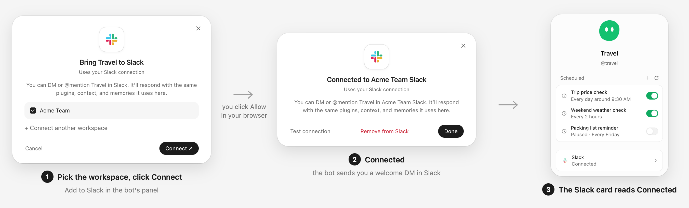

# Slack Connect

One-click Slack for Hermes bots. In Hermes Desktop, a bot's Slack window gets a
**Connect** button: it creates a Slack app for that bot in your workspace, opens
Slack's Allow page, and when you click Allow the bot is in Slack. It answers
DMs and @mentions with the same plugins, context and memories it uses in
Hermes. **Remove from Slack** deletes the app again.

<p align="center">
  
</p>
<p align="center"><em>Connect, then you click Allow in your browser, then Connected. Demo workspace; Slack's own page is not shown.</em></p>

In the [Grokbot Override](../grokbot-override/README.md) the same window opens from **Add to Slack** in the
bot's profile panel, and the panel's Slack card reads **Connected** afterwards. Every app it creates gets the
full set of permissions the bot needs (the scopes in `common/core.py`).

Without this add-on, Hermes's Slack window falls back to the regular
"paste two tokens" dialog (Socket Mode). That dialog keeps working either way.

## How it works

- `slack-connect` is a Hermes dashboard plugin. It creates the Slack app from a
  manifest (`apps.manifest.create`), stores the bot's credentials in that bot's
  profile, and removes the app on request.
- Slack delivers events over HTTPS, so each Hermes host runs a small **relay**
  (`slack-relay/`, a Python aiohttp service bound to `127.0.0.1`). Your public
  HTTPS address forwards `/slack` to it. The relay checks Slack's signature and
  forwards each event to the bot's own Hermes HTTP endpoint.
- A Slack **configuration token** per workspace lets Hermes create apps. Slack
  rotates it every 12 hours; Hermes stores the rotating pair owner-only on the
  Hermes host and refreshes it before use.

## Requirements

- An always-on Hermes host (macOS or Linux) that runs your bots, with Hermes's
  API server enabled (the multiplexed gateway listener).
- A public HTTPS address that reaches that host. Either:
  - [Tailscale Funnel](https://tailscale.com/kb/1223/funnel) on the host (the
    installer can add the `/slack` path for you), or
  - your own tunnel or reverse proxy that forwards `https://your-host.example.com/slack/*`
    to `http://127.0.0.1:8655/slack/*` (or with `/slack` stripped; both work).
- One Slack configuration token per workspace (see "Connect a bot" below).
  Creating apps needs a workspace member who may install apps.

Windows hosts are not supported yet; use the paste-tokens dialog there.

## Install

Run on the Hermes host, as the user that runs Hermes, from this repository:

```sh
# See exactly what will change, without changing anything:
slack-connect/install.sh --tailscale-funnel --dry-run

# Install, publishing /slack with Tailscale Funnel:
slack-connect/install.sh --tailscale-funnel

# ...or with your own tunnel or reverse proxy:
slack-connect/install.sh --public-url https://your-host.example.com
```

The installer:

- copies the plugin, the relay and the Slack HTTP platform source into your
  Hermes home (`$HERMES_HOME`, default `~/.hermes`);
- writes `~/.hermes/slack-connect/config.json` (mode 600) with the public URL,
  the relay port and Hermes's gateway listener, which it reads from Hermes's own
  configuration (override with `--gateway-url http://HOST:PORT`);
- enables `slack-connect` in the default profile through Hermes's own plugin
  selection (it never runs a dependency sync);
- starts the relay as a user service: launchd `ai.hermes.slack-ingress` on macOS,
  a systemd user unit `ai.hermes.slack-ingress.service` on Linux (for it to run
  while you are logged out, enable lingering: `loginctl enable-linger $USER`);
- with `--tailscale-funnel`, shows and runs exactly
  `tailscale funnel --bg --set-path=/slack http://127.0.0.1:8655`, after the relay
  answers locally. It never changes other Funnel or Serve paths, and refuses if
  `/slack` already points elsewhere or if turning Funnel on would expose other
  tailnet-only paths on port 443;
- ends with a self-check and prints **Ready** or exactly what is missing.

It **never restarts Hermes**. Re-running it is safe: unchanged files are left
alone, files it installed earlier are upgraded, and the relay is restarted only
when its code or settings changed. Files it did not install are never
overwritten; it stops and lists them. `--adopt` backs such files up under
`~/.hermes/slack-connect/backups/` and takes them over (for an earlier manual
install). `--replace-service NAME` moves an earlier launchd label or systemd unit
that runs this same relay out of the way. Other options: `--relay-port`,
`--dashboard-url` (the Hermes backend the self-check asks, default
`http://127.0.0.1:9119`), `--hermes-python`.

If the self-check reports the bootstrap route missing, Hermes has not loaded the
new plugin yet: it does on its next plugin reload or restart, which the
installer leaves to you.

## Connect a bot

1. In Hermes Desktop, open a bot, then its Slack window.
2. The first time, the window opens on **Connect another workspace**. On
   [api.slack.com/apps](https://api.slack.com/apps), under *Your App
   Configuration Tokens*, click **Generate Token** for your workspace and paste
   the **Refresh token** (`xoxe-…`). This is done once per workspace.
3. Pick the workspace and click **Connect**. Slack opens; click **Allow**.
4. The window shows *Connected*, and the bot sends you a welcome DM in Slack.

Connect changes only that bot's profile: it adds the Slack credentials to its
`.env`, turns on the bot's own Slack platform plugin, and, if the bot's
`config.yaml` has Slack switched off (`platforms.slack.enabled: false`, often
left from an older setup), switches it on with Hermes's own config helper. No
other setting is touched. If Connect fails or you later remove the bot from
Slack, the switch goes back to off.

## Remove a bot from Slack

Open the bot's Slack window and click **Remove from Slack**. This deletes the
bot's Slack app and its Slack credentials from the profile. Removal refreshes
that bot's messaging adapters (not the whole gateway); it waits until the bot
is idle.

## Uninstall

```sh
slack-connect/install.sh --uninstall --dry-run   # see what would be removed
slack-connect/install.sh --uninstall
```

This stops and removes the relay service, removes the `/slack` Funnel path if
the installer created it, deletes the files it installed and the config, and
turns `slack-connect` off in the default profile if the installer turned it on.
It keeps the workspace token store and `state.key` in `~/.hermes/slack-connect/`
(delete them yourself when no bot needs them).

**Connected bots' Slack apps are left alone.** They stop receiving events once
the relay is gone. Remove each bot from Slack first if you want the apps
deleted. Hermes processes that already loaded the plugin keep it until Hermes
next reloads them.

## Security notes

- The relay listens on loopback only. It answers `GET /healthz`,
  `POST /events/<app key>` and `GET /oauth/callback` (with or without the
  `/slack` prefix); every other path returns 404. It never exposes Hermes's own
  API: requests under `/slack/api/...` and anything else return 404.
- Events for unknown app keys return 404. Events for a known app must carry a
  valid Slack signature for that app (5 minute window), or they get 401. The
  only unsigned request accepted is Slack's URL check for an app created in the
  last 10 minutes.
- OAuth callbacks need a single-use, signed, 10 minute `state`; the workspace
  in Slack's answer must match the one the app was created in.
- The relay rate-limits unauthenticated requests per client (60 at once, then 1
  per second). Behind the loopback proxy the client is the right-most
  `X-Forwarded-For` address. Only outcomes that do not authenticate are charged
  (unknown key or path, bad signature or state, malformed body, health checks);
  a validly signed Slack request or an OAuth callback with a valid state is
  always processed, so other traffic cannot lock Slack out.
- Slack's team name is reduced to printable text (no control characters,
  quotes, backslash, backtick or `$`, at most 100 characters) and the
  installer's user id must be a plain Slack id before either is written to the
  bot's `.env`.
- The relay logs only the method, a sanitized path,
  the status and whether the request was a URL check. It never logs bodies,
  query strings or tokens. Log: `~/Library/Logs/hermes-slack-ingress.log`
  (macOS) or `~/.local/state/hermes-slack-ingress.log` (Linux).
- Workspace tokens, the state key and the config are owner-only files. Bot
  credentials are written to the bot's profile through Hermes's own `.env`
  helpers and passed to it on stdin, never on a command line.
- Each Slack app is created with only the scopes in `common/core.py`
  (`BOT_SCOPES`) and has Socket Mode and token rotation off.

## Troubleshooting

- **"Your URL didn't respond" on the app's Event Subscriptions page.** Known
  Slack label for apps created from a manifest: it can show even though events
  are delivered. If the bot answers DMs, ignore it. Don't click Retry while
  the app is being created.
- **The Slack window shows the paste-tokens dialog.** The add-on is not
  installed for that bot's host, or it is not ready. Run
  `slack-connect/install.sh --dry-run` on the host, then the installer; its
  self-check names the missing piece (config, relay, public URL).
- **"Slack setup token expired, add a new one".** The workspace's
  configuration token was not refreshed within its lifetime. Generate a new one
  on api.slack.com/apps and add the workspace again.
- **The bot doesn't answer in Slack.** Check `curl -s https://<your public
  address>/slack/healthz` returns `ok` from outside your network, then the relay
  log, then the bot's own gateway log for Slack HTTP lines. Use **Test
  connection** in the bot's Slack window.
- **Port 8655 is taken.** Re-run with `--relay-port <port>` and point your proxy
  at it.

## Limits

- One Hermes host per public address; the relay forwards to the gateway
  listener on that host.
- Slack Enterprise Grid org-wide apps are not supported.
- The app icon is set from the bot's avatar when Slack allows it; some
  configuration tokens can't set icons and the app then keeps Slack's default.
- macOS and Linux only.

## Tests

```sh
python -I -m pytest slack-connect/tests slack-check/tests -q
```

`test_platform.py` needs Hermes importable: run with Hermes's venv Python and
`HERMES_AGENT_DIR` pointing at the Hermes checkout. The rest needs pytest,
aiohttp and FastAPI (Hermes's venv has all three). `test_install.py` uses a
fake host: no launchd, systemd, Tailscale or Hermes is touched.
